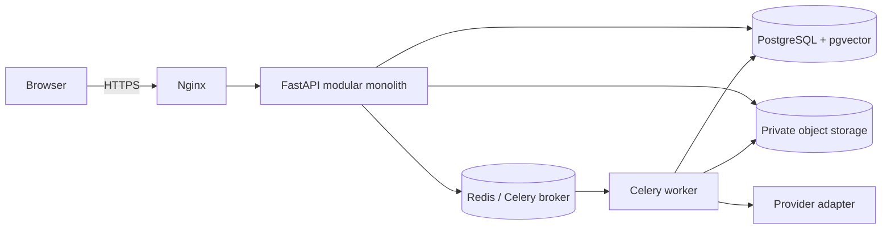

# Backend architecture

## Shape
Python modular monolith, deployed as API and worker processes from shared domain packages. FastAPI/Pydantic at transport boundaries; SQLAlchemy 2.x and Alembic for persistence/schema; PostgreSQL with pgvector for transactional data and embeddings; Redis as Celery broker/result backend. Object bytes reside in S3-compatible private storage, never in Postgres. Domains: identity, tenancy, courses, sources, ingestion, knowledge/retrieval, tutoring, practice, learning, plans, billing (future), audit.

## Boundaries and transaction rules
Routers validate/serialize; application services enforce policy and coordinate use cases; domain modules own invariants; repositories encapsulate SQLAlchemy queries; provider/storage adapters are replaceable. Keep one transaction per use case; publish jobs through a transactional outbox to avoid committed state without an enqueued task. Workers are at-least-once: tasks idempotent by operation key and source version. No network calls inside DB transactions.

## Data and runtime
UUID identifiers; UTC timestamps; soft-delete only where recovery/legal policy requires it; all queries are tenant-scoped in service/repository policy. PostgreSQL constraints are authoritative; application checks improve error messages. Redis contains no durable source of truth. Separate liveness from readiness; readiness checks required dependencies with short timeouts.

## Error handling and observability
Stable JSON error envelope: `code`, `message`, optional field `details`, `request_id`; never expose stack traces, SQL, prompts, or provider secrets. Map validation 422, unauthenticated 401, forbidden 403, missing 404, conflict 409, throttled 429, dependency failure 503. Log structured request/job IDs and domain outcome, redact content and credentials. Retry transient provider/network errors with bounded exponential backoff+jitter; do not retry invalid input or permanent authorization failures.

## Scaling and deviations
Scale API/worker independently; add read replicas or partitioning only when measured. Keep domain boundaries in one deployable system until independent ownership/scale justifies extraction. `apps/worker` is a process entry point, not a separate microservice domain. `packages/contracts` holds versioned API schemas; avoid duplicating canonical business models there.

## M1 implementation snapshot
Implemented domains are identity and courses/tenancy. The API has request IDs, JSON error envelopes, CORS/origin enforcement, Redis-backed rate limits, SQLAlchemy session management, and PostgreSQL readiness. The first Alembic migration creates identity, tenant, course, audit and outbox tables. The Celery worker polls the transactional outbox and delivers local SMTP through Mailpit.

M1 keeps transaction/policy code in domain routers rather than adding a thin service/repository layer without multiple callers. As content workflows arrive, extract application services for multi-step use cases and retain membership-scoped query helpers; do not let routers become the place for provider/network work. PostgreSQL is the source of truth; worker scheduling is persisted under a writable container temporary path.
