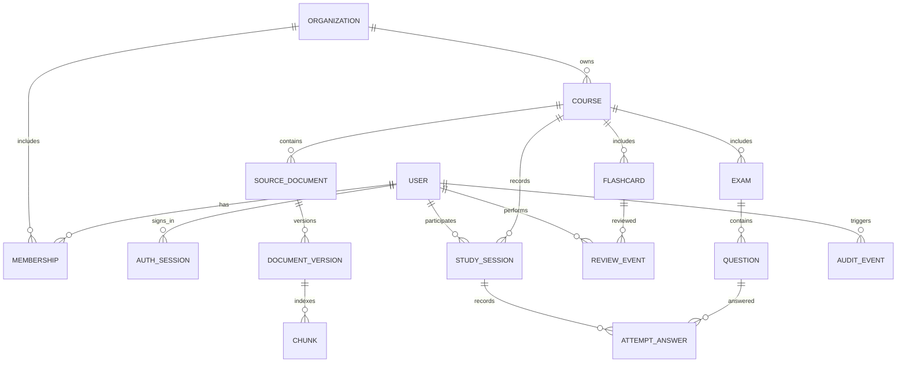

# Database model and ERD

## Implemented M1 schema
The first Alembic revision is `1e1ae554ed43_create_platform_foundation_tables`. It creates:
- `users`: UUID, normalized unique email, Argon2id password hash, verification/disabled timestamps and audit timestamps.
- `profiles`: one-to-one user FK, display name and locale.
- `organizations`: owner FK and name; registration provisions one personal organization.
- `memberships`: organization/user FKs, role constraint and unique organization/user pair.
- `courses`: organization and creator FKs, name/description, archive timestamp and tenant/archive ordering index.
- `auth_sessions`: user FK, unique session-token hash, CSRF-token hash, expiry/revocation and user/expiry indexes.
- `email_tokens`: user FK, purpose constraint, unique token hash, expiry/use state and user/purpose index.
- `audit_events`: optional actor/organization FKs, action/resource/request identifiers and metadata; content and credentials are not stored.
- `outbox_events`: versioned JSON payload, attempts and availability/processed timestamps with pending-work index.

UUID defaults and timestamps are supplied by SQLAlchemy in the application. The PostgreSQL migration has been applied and exercised in Compose. `pgvector` is available in the Postgres image, but no vector extension, embedding column or vector index is created until an embedding model/dimension and M2/M3 schema are approved.

## Planned schema
The ERD and the following learning entities are design-only until their milestones: source documents/versions/chunks, study sessions, flashcards/review events, exams/questions/attempt answers, mastery and plans. Any future tenant-owned foreign key must preserve tenant scope. Never treat vector similarity as authorization.

## Target entities and invariants
- `users`: UUID PK, normalized unique email, password hash (or external identity subject), verified/disabled timestamps, created/updated.
- `auth_sessions`: UUID PK, user FK, hash of opaque session secret (never raw token), created/last-seen/expiry/revocation timestamps, minimal device metadata; index unique token hash and `(user_id, revoked_at, expires_at)`.
- `organizations`: UUID PK, owner user, name, plan/status. Initial product provisions one personal organization per user.
- `memberships`: organization/user FK, role enum, unique `(organization_id,user_id)`. Roles owner/admin/member; authorization defaults deny.
- `courses`: organization FK, name, description, archived/deleted timestamps; index `(organization_id, archived_at)`.
- `source_documents`: course FK, uploader, display name, MIME, byte size, checksum, state, object key, deletion timestamp; unique `(course_id, checksum)` where active; index `(course_id,state)`.
- `document_versions`: source FK, monotonically increasing version, parser/version metadata, status, unique `(source_id,version)`.
- `chunks`: version FK, ordinal, text, page/offset metadata, token count, embedding `vector(1536)` only if chosen embedding model dimension is confirmed; unique `(version_id,ordinal)`. HNSW cosine index after dimension/model decision; B-tree `(version_id,ordinal)`. Never use vector similarity as authorization.
- `study_sessions`: user/course FK, started/ended, mode and metadata; index `(user_id,course_id,started_at DESC)`.
- `flashcards`: course FK, prompt/answer, optional source chunk FK, creator, state; index `(course_id,state)`.
- `review_events`: user/card FK, rating, latency, due-before/after, scheduler version, created; index `(user_id,card_id,created_at DESC)`.
- `exams`, `questions`, `attempt_answers`: course-bound generated or authored practice, source references, rubric/answer key protected from active test UI, immutable attempt records.
- `audit_events`: actor, organization, action, resource type/id, request ID, timestamp; no raw document/prompt content.
- `outbox_events`: event ID, aggregate, payload schema version, available/processed timestamps, delivery attempts; index pending delivery.

Use FK `ON DELETE RESTRICT` for core relational data and explicit deletion workflow for objects/vectors/audit policy. For all tenant-owned resources, include organization ID (directly or through course) in authorization queries and preferably composite uniqueness/FKs to prevent cross-tenant references. Migrations must add extensions/indexes with operational rollback notes. Decide embedding dimensions before first production migration; do not silently mix model versions.

## Retention and performance
Avoid storing generated answer text unless user history is explicitly enabled; retention is configurable by product/legal policy. Partition audit/review events only after measured volume. Use `EXPLAIN ANALYZE` on tenant-scoped retrieval and add indexes from observed query plans.
